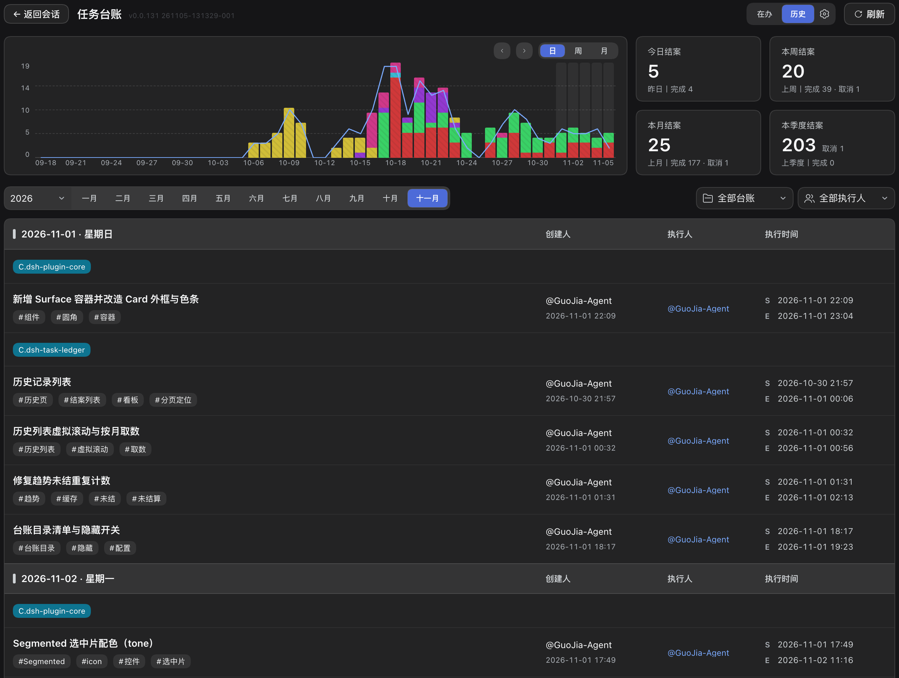

# dsh-task-ledger

[简体中文](README.md) · **English**

A task ledger that lives in your workspace: any kind of task is fair game — not just development work, but research, documentation, presentations and video production. Tasks are created, claimed, advanced and closed by the agent, and every one of those steps is written into a plain-text `ledger/` directory — so the owner, the current state, the next step and the conclusion stay on record instead of dissolving into chat history.


## Why it exists

Work that spans several sessions, several days or several people loses three answers: who is doing it, how far it has progressed, and what it was supposed to achieve. A chat log does not preserve them reliably, and a hosted project tool keeps them outside the workspace, away from the work they describe.

This ledger keeps those answers inside the workspace, in files that can be read, diffed and reviewed. Four properties define it:

| Property | What it means |
|---|---|
| **Task lifecycle tracking** | Tasks are created, claimed, resumed, handed over and closed. Every transition carries a timestamp and an owner; free-form progress, the conclusion and open issues live in the task document. |
| **Local by design** | No account, no hosted backend, no service marketplace. The ledger is plain JSON and Markdown committed with the repository; it works offline and can be reviewed line by line. |
| **Single-user and multi-user** | One person on one machine, or a team sharing one repository. Ownership state is sharded per person, so two people advancing two tasks never write the same file. |
| **Version control as the sync layer** | Git is the transport. Push, pull and merge carry the ledger between machines and contributors, and commit history doubles as the audit trail. |

## Using it

There are no commands for you to type. The ledger is driven by what you say to the agent: when a request matches one of the intents below, the agent runs the corresponding operation and records it.

| You say | What the agent does | Result |
|---|---|---|
| "Open a task: get the release pipeline working" | creates the task with the tags you gave | In the shared pool, state `open`, unclaimed |
| "Open a task and start on it" | creates and claims it | Owned by you, state `doing` |
| "I'll take that one" / "continue with X" | claims the task | Moved to your name, state `doing` |
| *(while working)* | writes the task document, then appends an execution record | Progress, conclusions and blockers on record |
| "Blocked for now" / "leave it for a while" | records the blocker, leaves the state alone | Still `doing` — a pause is neither a release nor a cancellation |
| "Hand it back" | releases it | Returns to the shared pool for anyone to claim |
| "Close this task" | closes it with your summary | One row written to history; read-only afterwards |
| "Cancel it" | closes it as void, with the reason | Closed, not completed |
| "Delete it" | asks you to confirm, then deletes | Removed permanently — no undo, no restore |
| "What should I be doing?" / "what did we close last week?" | lists in-flight tasks, one task, or history | Query only, nothing written |

Creating a task requires two inputs: **what the work is** — one sentence, without category or project prefixes — and **what it touches** — one to five tags. A category may be given at creation; it is immutable afterwards.

Four rules bind the agent:

- It never creates, claims, releases, closes or deletes a task on its own initiative. Each of those needs an explicit instruction from you, and a vague "done" is answered with a question rather than a closure.
- It never edits state files, the history file or the execution log. Only the task document's first five sections are its to write.
- It completes the written record before closing: a closed task cannot be written to again.
- When it cannot find a task for the work at hand, it asks whether to create one instead of registering work you did not ask for.

## Installing on DeepSeek Harness

The main form of this project is a plugin for [DeepSeek Harness](https://github.com/deepseek-ai/deepseek-harness) (dsh): installing it gives you the full board, with the skill bundled in, so there is nothing else to install. Pick any of the three ways below.

1. **Add a plugin in DSH** — open the plugins page, click "Add plugin", enter the package name `dsh-task-ledger` and confirm.
2. **Install from the command line**:

   ```bash
   dsh plugin add dsh-task-ledger
   ```

3. **Install from the plugin marketplace** — search for `dsh-task-ledger` in the DSH plugin marketplace and install it.

## Use from other agents

If you use several agent tools, install this Skill in each of them to keep the ledger; the same skill installed in another agent still writes to this project's ledger, and the board sums it up. Three steps:

### 1. Install the skill

```bash
npx skills add cq-guojia/dsh-task-ledger -g
```

The command detects the agents installed on this machine (Claude Code, Codex, CodeBuddy, …) and writes into each skills directory. Or send this line to any agent and let it install:

> Install the task-ledger skill (npm package task-ledger, GitHub repo cq-guojia/dsh-task-ledger).

### 2. Inject the rules (optional)

Add this to `AGENTS.md` in the project root so the agent follows the ledger convention:

```markdown
Usage rules for the task-ledger tool [task-ledger skill]:

- **Task progress, work items and work logs**: (create / advance / query / close) go through the task-ledger skill; answer questions about progress and task history from it, never from conversation memory or a hand-rolled list.
- **Creation anchor**: register a task only when the user explicitly asks for a new one ("open a task", "log this first", "create a task"); questions, queries, discussion and small incidental edits do not count — ask when unsure, and never create a task without an explicit instruction.
- **How to create and in what order**: the authorization and confirmation rules all follow the task-ledger skill's own instructions.
- **Ask in passing**: when the user is pushing forward work that spans turns (this turn ends with actions still on your plate) and has never mentioned tracking it, ask once after answering: "Want me to open a ledger for this task? (Ignore this if not needed — no reply necessary.)"; once asked in a session, do not ask again; no reply means ignore it.
```

### 3. Manage it on the board

The board is currently available only as a DeepSeek Harness plugin board. To view and manage these tasks on a board, install the plugin as described under [Installing on DeepSeek Harness](#installing-on-deepseek-harness).

Claude Code, Cursor, Codex, CodeBuddy, Trae, and any agent tool that loads `SKILL.md` are supported. For manual installation, identity setup and the skills directory of each agent, see the [skill package documentation](packages/skill/README.md).

## Other

The ledger lives in a `ledger/` directory, with state and prose kept apart: JSON holds who owns what and in which state, Markdown holds the reasoning. Only the CLI writes state, history and the execution log; the agent writes the first five sections of a task document and nothing else.

```
ledger/
├── pool.json                 unclaimed tasks (shared)
├── owners.json               index: identity → shard file
├── owners/<hash>.json        one shard per person: tasks they own
├── worklog/<YYYYMM>/*.md     task documents, six fixed sections
└── history/<YYYYMM>.md       closed tasks, one row each
```


The board shows in-flight tasks by owner, unclaimed work, overdue and stalled items, weekly trend, and a history view that aggregates closed tasks by day, week, month and quarter.



Tasks can be closed from the board in two ways: directly, with a one-line summary, or by handing the task back to the agent, which reads the recorded progress, writes the conclusion and open issues, then closes it.


Detailed documentation lives in each package: [plugin](packages/plugin/README.md) · [skill](packages/skill/README.md).

## Development

```bash
npm test        # Go: vet + unit tests
cd packages/plugin && npm run verify   # build + typecheck
```

## Licence

MIT — see [LICENSE](LICENSE).
