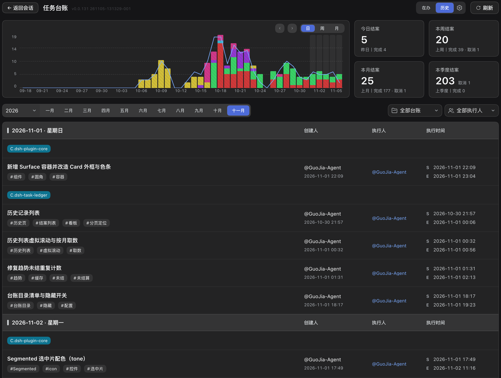

# dsh-task-ledger

**English** · [简体中文](README.zh-CN.md)

Task tracking for AI coding agents. A task is opened, claimed, advanced and closed by the agent itself, and every one of those steps is written into a plain-text `ledger/` directory inside the repository — so the owner of a task, its current state, the next step and the conclusion remain on record instead of dissolving into chat history.


## Why it exists

Work that spans several sessions, several days or several people loses three answers: who is doing it, how far it has progressed, and what it was supposed to achieve. A chat log does not preserve them reliably, and a hosted project tool keeps them outside the repository, away from the code they describe.

This ledger keeps those answers next to the code, in files that can be read, diffed and reviewed. Four properties define it:

| Property | What it means |
|---|---|
| **Task lifecycle tracking** | Tasks are created, claimed, resumed, handed over and closed. Every transition carries a timestamp and an owner; free-form progress, the conclusion and open issues live in the task document. |
| **Local by design** | No account, no hosted backend, no service marketplace. The ledger is plain JSON and Markdown committed with the repository; it works offline and is reviewable in a pull request. |
| **Single-user and multi-user** | One person on one machine, or a team sharing one repository. Ownership state is sharded per person, so two people advancing two tasks never write the same file. |
| **Version control as the sync layer** | Git is the transport. Push, pull and merge carry the ledger between machines and contributors, and commit history doubles as the audit trail. |

## Two packages

This repository ships one capability in two forms. They share a single source of truth for the skill, so the two never drift apart.

| Package | Form | Who it is for | Install |
|---|---|---|---|
| [`dsh-task-ledger`](https://www.npmjs.com/package/dsh-task-ledger) | Plugin for [DeepSeek Harness](https://www.npmjs.com/package/@deepseek-ai/dsh): full board UI, with the skill bundled | dsh users | `dsh plugin add dsh-task-ledger` |
| [`task-ledger`](https://www.npmjs.com/package/task-ledger) | Standalone skill: instructions, CLI and assets only | Claude Code, Cursor, Codex, CodeBuddy, WorkBuddy, Trae, and any other agent that loads `SKILL.md` | see below |

Detailed documentation lives in each package: [plugin](packages/plugin/README.md) · [skill](packages/skill/README.md).

## Installing the skill in an agent

### With a skill manager

The [skills CLI](https://skills.sh) (Vercel) writes the skill into every agent it detects and keeps it updated:

```bash
npx skills add https://github.com/cq-guojia/dsh-task-ledger/tree/main/packages/skill
```

The path matters: this repository holds two copies of the skill, and pointing at `packages/skill` selects the source. Add `-g` to install for all projects instead of the current one.

[SkillHub](https://skillhub.cn) and the markets built into CodeBuddy and WorkBuddy install a skill once it is listed; when search does not find `task-ledger`, use the client's local import and point it at `packages/skill`, or add this repository as a GitHub source.

### Manually

The skill is a directory containing `SKILL.md` and a prebuilt CLI. Installing it means copying that directory into the skills directory of the agent you use. Fetch the source once:

```bash
git clone --depth 1 https://github.com/cq-guojia/dsh-task-ledger.git /tmp/task-ledger-src
```

Then copy it to the location your agent reads. User-level paths apply to every project; project-level paths apply to one repository and are committed, which is how a team shares the same skill.

| Agent | User-level directory | Command |
|---|---|---|
| Claude Code | `~/.claude/skills/` | `mkdir -p ~/.claude/skills && cp -R /tmp/task-ledger-src/packages/skill ~/.claude/skills/task-ledger` |
| Cursor | `~/.cursor/skills/` | `mkdir -p ~/.cursor/skills && cp -R /tmp/task-ledger-src/packages/skill ~/.cursor/skills/task-ledger` |
| Codex CLI | `~/.codex/skills/` | `mkdir -p ~/.codex/skills && cp -R /tmp/task-ledger-src/packages/skill ~/.codex/skills/task-ledger` |
| CodeBuddy | `~/.codebuddy/skills/` | `mkdir -p ~/.codebuddy/skills && cp -R /tmp/task-ledger-src/packages/skill ~/.codebuddy/skills/task-ledger` |
| WorkBuddy | `~/.workbuddy/skills/` | `mkdir -p ~/.workbuddy/skills && cp -R /tmp/task-ledger-src/packages/skill ~/.workbuddy/skills/task-ledger` |
| Trae | `~/.trae/skills/` (Trae CN: `~/.trae-cn/skills/`) | `mkdir -p ~/.trae/skills && cp -R /tmp/task-ledger-src/packages/skill ~/.trae/skills/task-ledger` |

Notes:

- **Project-level install** — the same copies work under the repository: `.claude/skills/`, `.cursor/skills/`, `.codebuddy/skills/`, `.trae/skills/`, or `.agents/skills/` for the cross-agent convention read by Codex and Cursor.
- **Doubao Work (豆包工作)** — import the folder from the application: open the sidebar, choose Skills, and import `packages/skill` as a local skill.
- **Windows** — substitute `%USERPROFILE%\` for `~`. Everywhere below, replace `scripts/progress` with `scripts\bin\ledger-windows-amd64.exe`: CreateProcessW cannot execute an extensionless sh wrapper (it appends `.exe`, finds nothing, and fails). The wrapper still works under Git Bash / WSL.
- The repository holds two identical copies: `packages/skill/` is the source, `packages/plugin/skill/` is the copy bundled into the dsh plugin. Either may be installed; the content is the same.

Once installed, run the identity setup once per machine. It is interactive and must be run by you, not by the agent:

```bash
~/.claude/skills/task-ledger/scripts/progress init
```

Requirements: Git 2.27 or newer for multi-user synchronisation. No runtime, package manager or network access is required afterwards — the CLI ships as a static binary for Linux, macOS and Windows.

## Using it

There are no commands for you to type. The ledger is driven by what you say to the agent: when a request matches one of the intents below, the agent runs the corresponding operation and records it.

| You say | What the agent does | Result |
|---|---|---|
| "Open a task: get the release pipeline working" | creates the task with the tags you gave | In the shared pool, state `open`, unclaimed |
| "Open a task and start on it" | creates and claims it | Owned by you, state `doing` |
| "I'll take that one" / "continue with X" | claims the task | Moved to your name, state `doing` |
| *(while working)* | writes the task document, then appends an execution record | Progress, conclusions and blockers on record |
| "Blocked for now" / "leave it for a while" | records the blocker, leaves the state alone | Still `doing` — a pause is neither a release nor a cancellation |
| "Hand it back" | releases it | Returns to the shared pool for anyone to claim |
| "Close this task" | closes it with your summary | One row written to history; read-only afterwards |
| "Cancel it" | closes it as void, with the reason | Closed, not completed |
| "Delete it" | asks you to confirm, then deletes | Removed permanently — no undo, no restore |
| "What should I be doing?" / "what did we close last week?" | lists in-flight tasks, one task, or history | Query only, nothing written |

Creating a task requires two inputs: **what the work is** — one sentence, without category or project prefixes — and **what it touches** — one to five tags. A category may be given at creation; it is immutable afterwards.

Four rules bind the agent:

- It never creates, claims, releases, closes or deletes a task on its own initiative. Each of those needs an explicit instruction from you, and a vague "done" is answered with a question rather than a closure.
- It never edits state files, the history file or the execution log. Only the task document's first five sections are its to write.
- It completes the written record before closing: a closed task cannot be written to again.
- When it cannot find a task for the work at hand, it asks whether to create one instead of registering work you did not ask for.

### Recommended: put it in your rules file

The skill only loads when a request matches one of those intents, and "should this piece of work be tracked" is not one of them. A standing rule in the project's `AGENTS.md` (or whichever rules file your agent reads) is far more reliable on its own. Copy this block:

```markdown
- **Every piece of task progress, work item and work log (create / advance / query / close) goes through the `task-ledger` skill**; answer progress and history questions from it, never from conversation memory or a hand-rolled list.
- **Creation anchor**: hand something to `task-ledger` only when the user explicitly asks for a new task ("open a task", "log this first", "create a task"). Questions, queries, discussion and small incidental edits do not count — ask when unsure, and never create a task without an explicit instruction.
- **Ask in passing**: when the user is pushing forward work that spans turns (this turn ends with actions still on your plate) and has never mentioned tracking it, ask once after answering: "你现在这个任务是需要帮你建一个台账吗？（如果无需，忽略这句话，也不用去回复。）" Once asked in a session, do not ask again; no reply means ignore it.
```

Without it the skill still works — it just acts only when you mention the task yourself.

## What gets written

```
ledger/
├── pool.json                 unclaimed tasks (shared)
├── owners.json               index: identity → shard file
├── owners/<hash>.json        one shard per person: tasks they own
├── worklog/<YYYYMM>/*.md     task documents, six fixed sections
└── history/<YYYYMM>.md       closed tasks, one row each
```

State and prose are kept apart: JSON holds who owns what and in which state, Markdown holds the reasoning. Only the CLI writes state, history and the execution log; the agent writes the first five sections of a task document and nothing else.


## The board

The dsh plugin adds a board on top of the same data: in-flight tasks by owner, unclaimed work, overdue and stalled items, weekly trend, and a history view that aggregates closed tasks by day, week, month and quarter.



Tasks can be closed from the board in two ways: directly, with a one-line summary, or by handing the task back to the agent, which reads the recorded progress, writes the conclusion and open issues, then closes it.


## Development

```bash
npm test        # Go: vet + unit tests
cd packages/plugin && npm run verify   # build + typecheck
```

## Licence

MIT — see [LICENSE](LICENSE).
