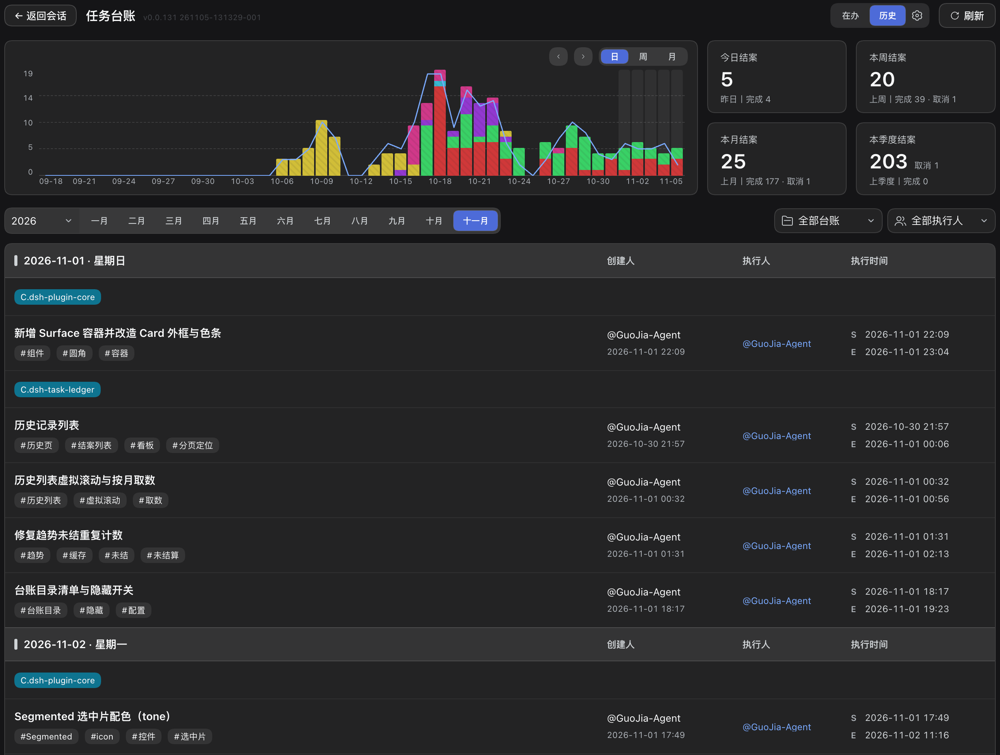

# dsh-task-ledger

[English](README.md) · **简体中文**

面向 AI 编码代理的任务台账。任务由代理自行创建、认领、推进与结案，每一步都写入仓库内的纯文本 `ledger/` 目录 —— 谁在做、做到哪、下一步是什么、结论是什么，全程留痕，不会随对话窗口关闭而丢失。


## 它解决什么问题

只要一件工作跨了多次会话、跨了若干天，或者由多人接力，三个问题就再也答不上来：谁在做、做到哪一步、原本要达成什么。对话记录答不上来，托管型项目管理工具虽然答得上，却把答案留在了仓库之外、离它所描述的代码很远的地方。

本台账把这些答案放在代码旁边，以可读、可 diff、可评审的文件形式保存。它的定位由四点界定：

| 特性 | 具体含义 |
|---|---|
| **任务全生命周期跟踪** | 任务可创建、认领、续做、移交、结案。每次状态变更都带时间与责任人；过程叙述、结案结论与遗留问题写在任务正文中。 |
| **本地化工具** | 不需要账号、不需要托管后端、不依赖任何服务市场。台账是与仓库一同提交的 JSON 与 Markdown，离线可用，可在代码评审中逐行审阅。 |
| **单人可用，多人亦可用** | 单机单人可直接使用；团队共用一个仓库同样成立。归属状态按人分片存储，两人各自推进各自的任务时不会写同一份文件。 |
| **以 Git 承载版本同步** | Git 即传输通道。push、pull、merge 把台账带到其他机器与其他人，提交历史本身构成审计记录。 |

## 两个包

同一套能力以两种形态发布。skill 内容只有一个真源，两者不会产生分歧。

| 包 | 形态 | 适用对象 | 安装 |
|---|---|---|---|
| [`dsh-task-ledger`](https://www.npmjs.com/package/dsh-task-ledger) | [DeepSeek Harness](https://www.npmjs.com/package/@deepseek-ai/dsh) 插件：完整看板界面，内置 skill | dsh 用户 | `dsh plugin add dsh-task-ledger` |
| [`task-ledger`](https://www.npmjs.com/package/task-ledger) | 独立 skill：仅含执行说明、命令行与资源 | Claude Code、Cursor、Codex、CodeBuddy、WorkBuddy、Trae，以及其他加载 `SKILL.md` 的代理 | 见下一节 |

各包的完整说明：[插件](packages/plugin/README.zh-CN.md) · [skill](packages/skill/README.zh-CN.md)。

## 为 AI 编码代理安装技能

部署分为三个阶段：把技能安装到代理的技能目录（本节）、在项目规则文件中声明常驻规则（可选，见下文），以及 —— 使用 dsh 插件时 —— 把仓库登记为台账目录，交由看板汇总。后两步见「在其他 Agent 中使用」。

### 通过技能管理工具安装

[skills CLI](https://skills.sh)（Vercel）会识别本机已安装的 AI 编码代理，将技能写入各自的**用户级技能目录**，并支持后续更新：

```bash
npx skills add cq-guojia/dsh-task-ledger -g
```

参数为 GitHub 仓库坐标：该工具解析仓库后在 monorepo 内定位 `SKILL.md` 技能。`-g` 表示用户级安装，对所有项目生效；省略则仅作用于当前项目，`--agent` 可限定目标代理。注意该工具不接受 npm 包名作为来源。如需锁定来源目录，也可使用树路径形式 `https://github.com/cq-guojia/dsh-task-ledger/tree/main/packages/skill`。

[SkillHub](https://skillhub.cn) 以及 CodeBuddy、WorkBuddy 内置的技能市场，在技能已上架时可直接安装；检索不到 `task-ledger` 时，改用客户端「导入本地技能」指向 `packages/skill`，或在 SkillHub 桌面版中把本仓库添加为 GitHub 来源。

**委托代理自行安装。** 也可将安装动作委托给代理本身，向它发送以下提示词：

> 帮我安装 task-ledger 这个 skill（npm 包名 task-ledger，GitHub 包名 cq-guojia/dsh-task-ledger）。

npm 包名与 GitHub 仓库坐标指向同一份技能；代理自行解析来源并安装到它所读取的技能目录。

### 手动安装

skill 就是一个包含 `SKILL.md` 与预编译命令行的目录。安装即：把该目录复制到你所使用代理的技能目录。先取一份源码：

```bash
git clone --depth 1 https://github.com/cq-guojia/dsh-task-ledger.git /tmp/task-ledger-src
```

再按代理复制到下列位置。用户级目录对所有项目生效；项目级目录只对单个仓库生效，且可随仓库提交，这是团队共用同一份 skill 的方式。

| 代理 | 用户级目录 | 命令 |
|---|---|---|
| Claude Code | `~/.claude/skills/` | `mkdir -p ~/.claude/skills && cp -R /tmp/task-ledger-src/packages/skill ~/.claude/skills/task-ledger` |
| Cursor | `~/.cursor/skills/` | `mkdir -p ~/.cursor/skills && cp -R /tmp/task-ledger-src/packages/skill ~/.cursor/skills/task-ledger` |
| Codex CLI | `~/.codex/skills/` | `mkdir -p ~/.codex/skills && cp -R /tmp/task-ledger-src/packages/skill ~/.codex/skills/task-ledger` |
| CodeBuddy | `~/.codebuddy/skills/` | `mkdir -p ~/.codebuddy/skills && cp -R /tmp/task-ledger-src/packages/skill ~/.codebuddy/skills/task-ledger` |
| WorkBuddy | `~/.workbuddy/skills/` | `mkdir -p ~/.workbuddy/skills && cp -R /tmp/task-ledger-src/packages/skill ~/.workbuddy/skills/task-ledger` |
| Trae | `~/.trae/skills/`（Trae 国内版：`~/.trae-cn/skills/`） | `mkdir -p ~/.trae/skills && cp -R /tmp/task-ledger-src/packages/skill ~/.trae/skills/task-ledger` |

补充说明：

- **项目级安装** — 同样的复制方式也适用于仓库内：`.claude/skills/`、`.cursor/skills/`、`.codebuddy/skills/`、`.trae/skills/`，以及 Codex 与 Cursor 都能读取的跨代理约定目录 `.agents/skills/`。
- **豆包工作** — 在应用内导入：打开侧栏，进入「技能」，将 `packages/skill` 作为本地技能导入。
- **Windows** — 将路径中的 `~` 替换为 `%USERPROFILE%\`；并且下面所有 `scripts/progress` 都要换成 `scripts\bin\ledger-windows-amd64.exe`（无扩展名的 sh 包装在 Windows 上不可执行：CreateProcessW 会按扩展名补 `.exe` 去找，然后报找不到）。在 Git Bash / WSL 里仍可用 `scripts/progress`。
- 仓库内有两份内容完全相同的副本：`packages/skill/` 为源，`packages/plugin/skill/` 是随 dsh 插件一起分发的副本。装哪一份都可以，内容一致。

安装完成后，每台机器需执行一次身份初始化。该步骤为交互式，必须由你本人执行，不能交由代理代做：

```bash
~/.claude/skills/task-ledger/scripts/progress init
```

环境要求：多人同步需 Git 2.27 及以上。此后无需任何运行时、包管理器或网络 —— 命令行以静态二进制形式提供，覆盖 Linux、macOS 与 Windows。

## 怎么用

不需要你敲任何命令。台账由你对代理说的话驱动：请求命中下列意图时，代理执行对应操作并留痕。

| 你说 | 代理做什么 | 结果 |
|---|---|---|
| 「新建一个任务：把发布流程走通」 | 按你给的标签建任务 | 落公共池，状态「待认领」 |
| 「新建个任务并开始做」 | 建并认领 | 归你名下，状态「进行中」 |
| 「这活我领了」/「接着做 X」 | 认领该任务 | 转到你名下，状态「进行中」 |
| （干活过程中） | 写任务正文，再追加一条执行记录 | 进度、结论、卡点全程留痕 |
| 「卡住了」/「先放一放」 | 记下卡点，状态不动 | 仍是「进行中」—— 暂停既不是释放，也不是取消 |
| 「退回去」 | 释放任务 | 回公共池，任何人可认领 |
| 「这个任务结束掉」 | 带摘要结案 | 写入历史，此后只读 |
| 「取消 / 作废」 | 作废结案，记下原因 | 已关闭，但不算完成 |
| 「删除」 | 先请你确认，再删除 | 彻底删除，无撤销、无恢复 |
| 「现在该做什么」/「上周结了什么」 | 列在办、看单条、查历史 | 只读查询，不写任何东西 |

建任务需要两项输入：**做什么** —— 一句话，不加分类或项目名前缀；**涉及什么** —— 一到五个标签。分类可在建任务时给出，此后不可更改。

四条约束对代理生效：

- 建、认领、释放、结案、删除，没有一项由代理自行发起。每一项都需要你的明确指令；你只说了「做完了」这类含糊的话，它回问，而不是直接结案。
- 状态文件、历史文件、执行记录一律不由代理改动。它只能写任务正文的前五节。
- 结案前必须先把记录写完 —— 已结案的任务不能再写。
- 找不到对应任务时，它问你要不要新建，而不是替你登记你没要求登记的工作。

### 在项目规则文件中声明常驻规则

技能仅在请求命中明确的任务意图时加载，「当前工作是否应当登记」并不属于触发条件。因此需在项目根目录的 `AGENTS.md`（或所用代理的等价规则文件）中声明常驻规则。以下片段即 dsh 插件内置的默认提示词，与「会话规则注入」在每个 dsh 会话首轮投递的文本完全相同：

```markdown
任务台账工具[task-ledger skill]使用规则：

- **凡任务进度、工作事项与工作日志**：（新建 / 推进 / 查询 / 结案）一律调用 task-ledger skill 管理；进度 / 历史任务类问题一律走它作答，不凭对话记忆或自建清单顶替。
- **开工锚点**：仅当用户明确说要新建（如「开个新坑」「先记一下」「建个任务」）才登记；提问 / 查询 / 讨论 / 顺手小改不算，拿不准先问，未经明确指令不得擅自新建任务。
- **怎么建、按什么顺序**：命令的授权与确认口径，一律以 task-ledger skill 的说明为准。
- **顺手问一句**：用户在推进一件跨轮的事（这轮答完、手上还有下一步动作没做完）、却从没提过记账时，答完问一次「你现在这个任务是需要帮你建一个台账吗？（如果无需，忽略这句话，也不用去回复。）」；本会话问过一次就别再问，用户不接就当他不需要。
```

会话规则注入默认开启时，dsh 会话无需再写入该片段；其他代理仍需写入，因为注入仅作用于 dsh 会话。两种机制均未启用时技能依然可用，但仅在用户明确提及任务时生效。

## 落盘的数据

```
ledger/
├── pool.json                 公共池:未认领任务
├── owners.json               索引:身份 → 分片文件
├── owners/<hash>.json        每人一份分片:其名下任务
├── worklog/<年月>/*.md       任务正文,固定六节
└── history/<年月>.md         已结案任务,一行一条
```

状态与正文分离：JSON 记录归属与状态，Markdown 记录来龙去脉。只有命令行工具可写状态、历史与执行记录；代理只能写任务正文的前五节，其余一律不改。


## 看板

dsh 插件在同一份数据之上提供看板：按责任人展示在办任务、待认领任务、逾期与停滞项、周度趋势，以及按日 / 周 / 月 / 季度聚合的结案历史。



任务可在看板上以两种方式结案：直接结案并写一句摘要；或交还给代理，由代理读完已记录的进度，写出结论与遗留问题，再行结案。


## 在其他 Agent 中使用

凡向同一仓库写入记录的代理共用一本台账。在另一个 AI 编码代理（Claude Code、Cursor、Codex、CodeBuddy、WorkBuddy、Trae，或任何加载 `SKILL.md` 的客户端）中安装同一份 Agent Skill，即可获得同一套命令，其记录写入看板所读取的同一个 `ledger/` 目录。

台账口径通过两条相互独立的机制送达代理：

| 机制 | 作用范围 | 投递方式 |
|---|---|---|
| **会话规则注入**（dsh 插件） | 仅 dsh 会话 | 插件在每个会话首轮注入一次默认提示词；默认开启，可在插件设置页配置，且不向工作区规则文件写入任何内容。 |
| **项目规则文件中的常驻规则** | 任意代理 | 同一段提示词写入 `AGENTS.md`（或等价规则文件），随仓库一同分发。 |

把其他代理的工作纳入看板需要三步：安装技能（`npx skills add cq-guojia/dsh-task-ledger -g`，或使用上文的委托安装提示词）；在 `AGENTS.md` 中声明常驻规则（若该代理是已开启注入的 dsh 会话则可省略）；在「设置 → 台账目录 → 添加目录」中登记项目根目录。看板只汇总本机已登记的目录，登记动作不改动任何台账数据。插件设置页提供同样的三步说明，并支持一键复制命令与提示词。

## 开发

```bash
npm test        # Go:vet 与单元测试
cd packages/plugin && npm run verify   # 构建与类型检查
```

## 许可

MIT，见 [LICENSE](LICENSE)。
