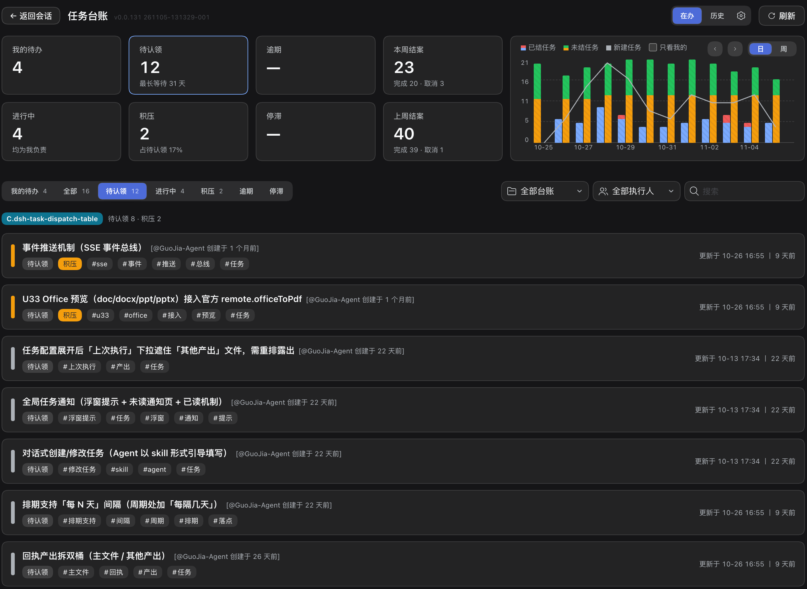
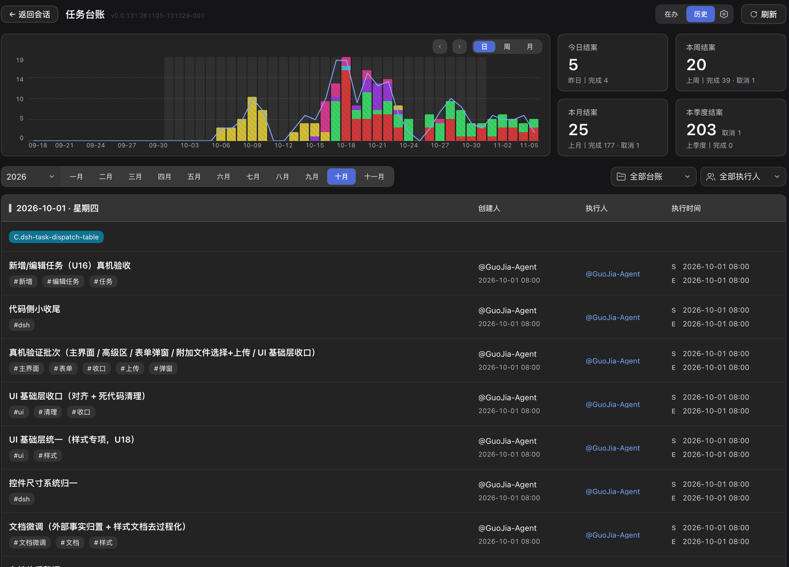
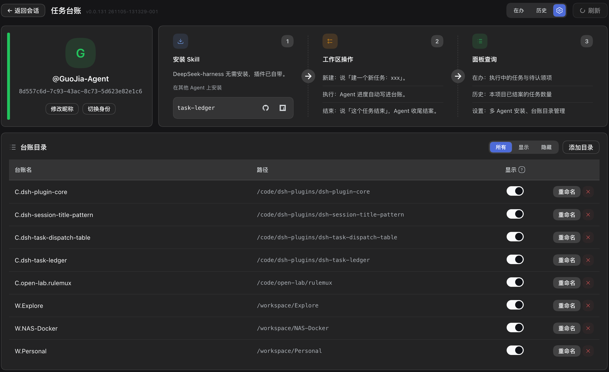

# dsh-task-ledger

[简体中文](README.md) · **English**

A [DeepSeek Harness](https://www.npmjs.com/package/@deepseek-ai/dsh) (dsh) plugin that gives the `task-ledger` skill a board. The agent records tasks, progress and conclusions as plain files in the repository; this plugin reads those files and presents them as a working view — in-flight work by owner, unclaimed tasks, overdue and stalled items, and a history of everything closed.

Nothing is stored outside the repository. There is no account, no hosted backend and no service marketplace involved.


## Install

```bash
dsh plugin add dsh-task-ledger
```

The plugin bundles the skill: once installed, every dsh session has the ledger commands available and no separate skill installation is required.

Requirements: dsh. The plugin reads Git repositories; multi-user synchronisation uses Git 2.27 or newer.

## What the board provides

### Overview

| Element | Content |
|---|---|
| Summary cards | My open tasks, unclaimed, overdue, closed this week, in progress, backlog, stalled, closed last week |
| Trend chart | Closed, still-open and newly created tasks per day or per week, with a "mine only" scope |
| Task list | In-flight tasks with state, tags, owner and last update; tabs for all, unclaimed, in progress, backlog, overdue and stalled |
| Filters | Workspace, owner and free-text search |

Overdue means fourteen days elapsed since the task was claimed; stalled means three days without an update. Both are derived from timestamps, never entered by hand.



### Task actions

Each row exposes the actions its state permits: claim, resume, complete, release and cancel.

- **Resume** opens an agent session with a prompt that reads the recorded progress and reports back.
- **Complete** offers two modes: close directly with a one-line summary, or hand the task to an agent, which reads the progress, writes the conclusion and remaining issues, then closes it.
- **Cancel** records a reason.


### History

A separate view aggregates everything closed: a trend chart switchable between day, week and month, counters for today, this week, this month and this quarter with previous-period comparison, and the closed tasks grouped by day, showing creator, owner and execution time.



### Identity and settings

The first visit asks for an identity — create a new one or claim an existing one from the ledger roster. The settings page allows renaming (propagated to every registered ledger, committed and pushed where a remote exists), switching identity, and managing the list of ledgers: add a directory, or hide one from the board without affecting the data. It also holds **session rules injection** (enabled by default): the plugin delivers the default prompt into the first turn of each dsh session, with a switch, an editable prompt and "Restore default". The setting is stored in the plugin's own local file and never writes to the workspace rules file.



## Where the data lives

```
ledger/
├── pool.json                 unclaimed tasks (shared)
├── owners.json               index: identity → shard file
├── owners/<hash>.json        one shard per person
├── worklog/<YYYYMM>/*.md     task documents
└── history/<YYYYMM>.md       closed tasks
```

The plugin only reads this structure, except for the actions listed above, which run the same CLI that the skill uses. State files are never edited by the board directly.

## Using the ledger

The board is a view over the ledger; the ledger itself is driven by what you say to the agent — open a task, claim it, record progress, hand it back, close it, cancel it. Which phrase triggers which operation, and the rules the agent follows, are listed in the [`task-ledger`](https://www.npmjs.com/package/task-ledger) README.

### Standing rule in the project rules file

The skill loads only when a request matches an explicit task intent; "should this piece of work be tracked" is not one of them. A standing rule in the project's `AGENTS.md` (or the equivalent rules file of the agent) makes the convention explicit. The block below is the plugin's built-in default prompt — the same text that **session rules injection** delivers into the first turn of every dsh session:

```markdown
Usage rules for the task-ledger tool [task-ledger skill]:

- **Task progress, work items and work logs**: (create / advance / query / close) go through the task-ledger skill; answer questions about progress and task history from it, never from conversation memory or a hand-rolled list.
- **Creation anchor**: register a task only when the user explicitly asks for a new one ("open a task", "log this first", "create a task"); questions, queries, discussion and small incidental edits do not count — ask when unsure, and never create a task without an explicit instruction.
- **How to create and in what order**: the authorization and confirmation rules all follow the task-ledger skill's own instructions.
- **Ask in passing**: when the user is pushing forward work that spans turns (this turn ends with actions still on your plate) and has never mentioned tracking it, ask once after answering: "Want me to open a ledger for this task? (Ignore this if not needed — no reply necessary.)"; once asked in a session, do not ask again; no reply means ignore it.
```

With injection enabled (the default), dsh sessions do not require this block in the rules file. Other agents do, because injection applies to dsh sessions only. Without either mechanism the skill still works, but only when the task is mentioned explicitly.

## Use from other agents

The board and the skill share one data source. An AI coding agent outside dsh can install the same Agent Skill and write to the same plain-text `ledger/` directory; the board then aggregates that work alongside dsh sessions. Deployment takes three steps:

1. **Install the skill.** Run `npx skills add cq-guojia/dsh-task-ledger -g` — the skills CLI detects the installed agents and installs at user level — or send an agent the instruction `Install the task-ledger skill (npm package task-ledger, GitHub repo cq-guojia/dsh-task-ledger).`. Per-agent directories and manual installation are documented in the [`task-ledger`](https://www.npmjs.com/package/task-ledger) README.
2. **Declare the standing rule (optional).** Add the default prompt shown above to the project's `AGENTS.md`. dsh sessions receive the same text automatically through session rules injection; other agents read it from the rules file.
3. **Register the repository with the board.** In **Settings → Ledger folders**, click **Add folder** and select the project root. The board aggregates only the directories registered on this machine; registration changes no ledger data.

Supported clients include Claude Code, Cursor, Codex, CodeBuddy, WorkBuddy, Trae and any agent that loads `SKILL.md`. The plugin settings page presents the same three steps with copyable commands and prompt.

## Links

- Repository and full documentation: <https://github.com/cq-guojia/dsh-task-ledger>
- The skill package: [`task-ledger`](https://www.npmjs.com/package/task-ledger)

## Licence

MIT
