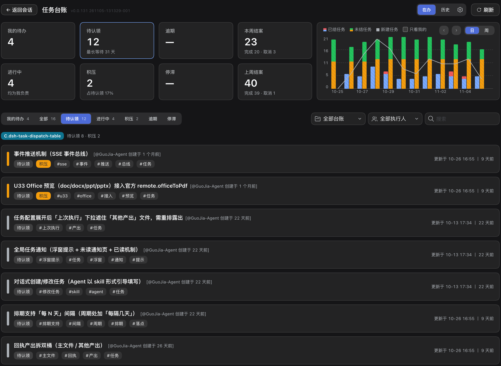
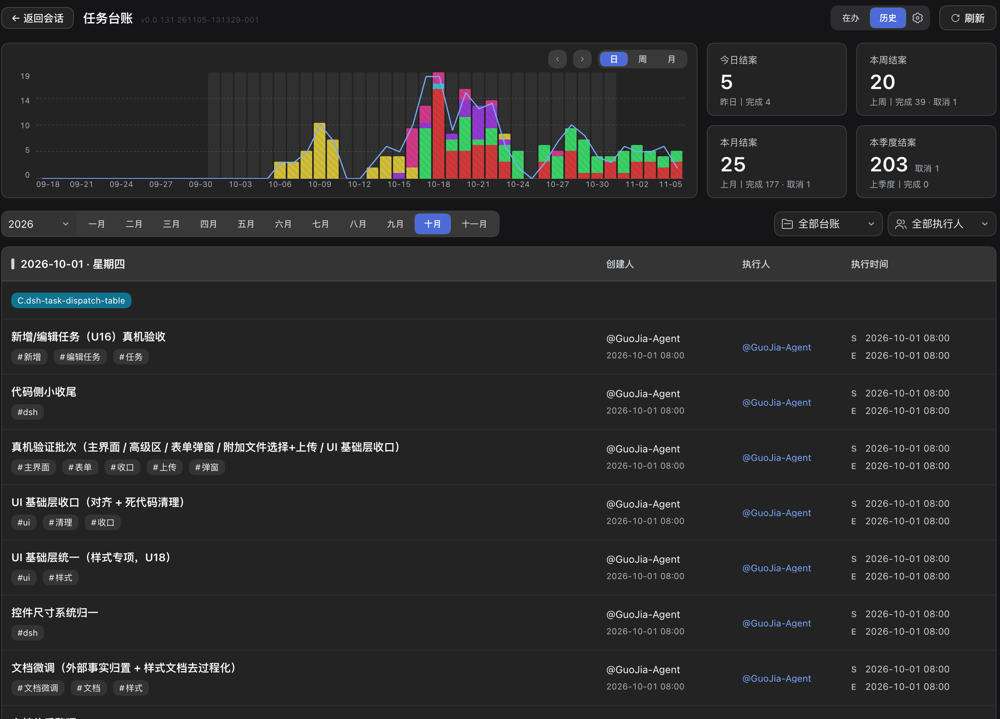
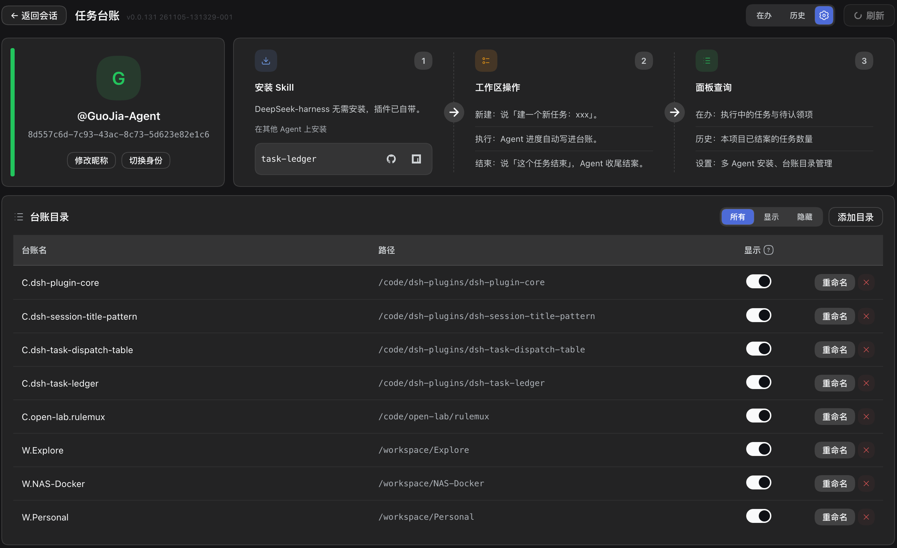

# dsh-task-ledger

**English** · [简体中文](https://github.com/cq-guojia/dsh-task-ledger/blob/main/packages/plugin/README.zh-CN.md)

A [DeepSeek Harness](https://www.npmjs.com/package/@deepseek-ai/dsh) (dsh) plugin that gives the `task-ledger` skill a board. The agent records tasks, progress and conclusions as plain files in the repository; this plugin reads those files and presents them as a working view — in-flight work by owner, unclaimed tasks, overdue and stalled items, and a history of everything closed.

Nothing is stored outside the repository. There is no account, no hosted backend and no service marketplace involved.


## Install

```bash
dsh plugin add dsh-task-ledger
```

The plugin bundles the skill: once installed, every dsh session has the ledger commands available and no separate skill installation is required.

Requirements: dsh. The plugin reads Git repositories; multi-user synchronisation uses Git 2.27 or newer.

## What the board provides

### Overview

| Element | Content |
|---|---|
| Summary cards | My open tasks, unclaimed, overdue, closed this week, in progress, backlog, stalled, closed last week |
| Trend chart | Closed, still-open and newly created tasks per day or per week, with a "mine only" scope |
| Task list | In-flight tasks with state, tags, owner and last update; tabs for all, unclaimed, in progress, backlog, overdue and stalled |
| Filters | Workspace, owner and free-text search |

Overdue means seven days elapsed since the task was claimed; stalled means three days without an update. Both are derived from timestamps, never entered by hand.



### Task actions

Each row exposes the actions its state permits: claim, resume, complete, release and cancel.

- **Resume** opens an agent session with a prompt that reads the recorded progress and reports back.
- **Complete** offers two modes: close directly with a one-line summary, or hand the task to an agent, which reads the progress, writes the conclusion and remaining issues, then closes it.
- **Cancel** records a reason.


### History

A separate view aggregates everything closed: a trend chart switchable between day, week and month, counters for today, this week, this month and this quarter with previous-period comparison, and the closed tasks grouped by day, showing creator, owner and execution time.



### Identity and settings

The first visit asks for an identity — create a new one or claim an existing one from the ledger roster. The settings page allows renaming (propagated to every registered ledger, committed and pushed where a remote exists), switching identity, and managing the list of ledgers: add a directory, or hide one from the board without affecting the data.



## Where the data lives

```
ledger/
├── pool.json                 unclaimed tasks (shared)
├── owners.json               index: identity → shard file
├── owners/<hash>.json        one shard per person
├── worklog/<YYYYMM>/*.md     task documents
└── history/<YYYYMM>.md       closed tasks
```

The plugin only reads this structure, except for the actions listed above, which run the same CLI that the skill uses. State files are never edited by the board directly.

## Using the ledger

The board is a view over the ledger; the ledger itself is driven by what you say to the agent — open a task, claim it, record progress, hand it back, close it, cancel it. Which phrase triggers which operation, and the rules the agent follows, are listed in the [`task-ledger`](https://www.npmjs.com/package/task-ledger) README.

## Other agents

Agents that are not dsh can install the same skill on its own — with the skills CLI, or by copying `packages/skill` into their skills directory; see the [`task-ledger`](https://www.npmjs.com/package/task-ledger) package for per-agent installation.

## Links

- Repository and full documentation: <https://github.com/cq-guojia/dsh-task-ledger>
- The skill package: [`task-ledger`](https://www.npmjs.com/package/task-ledger)

## Licence

MIT
