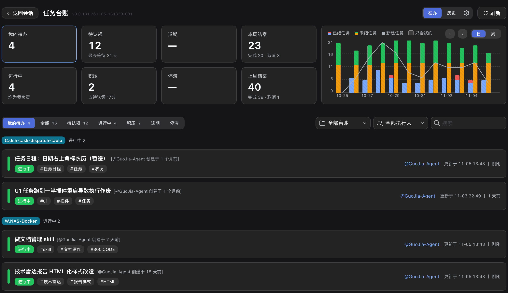
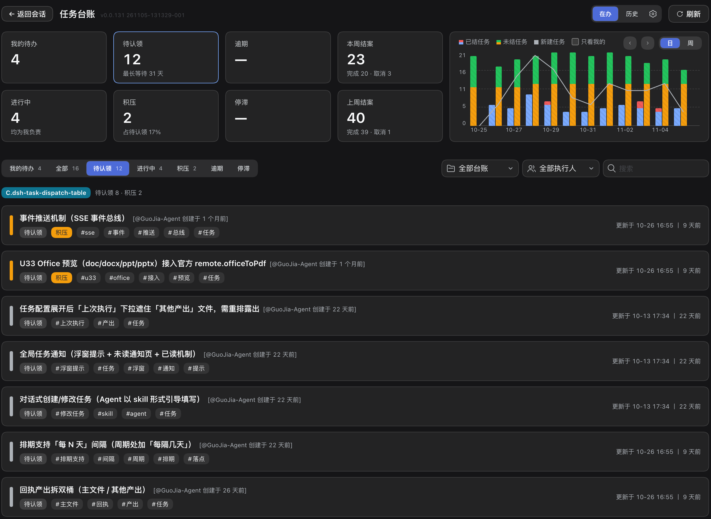
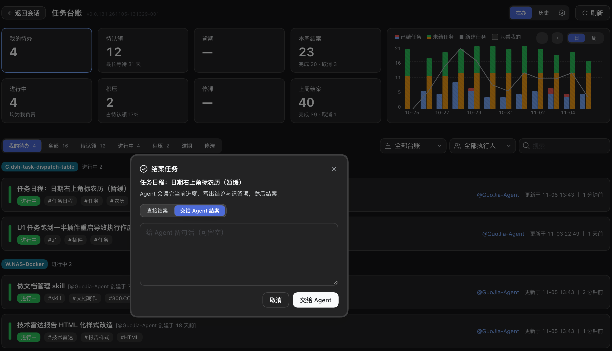
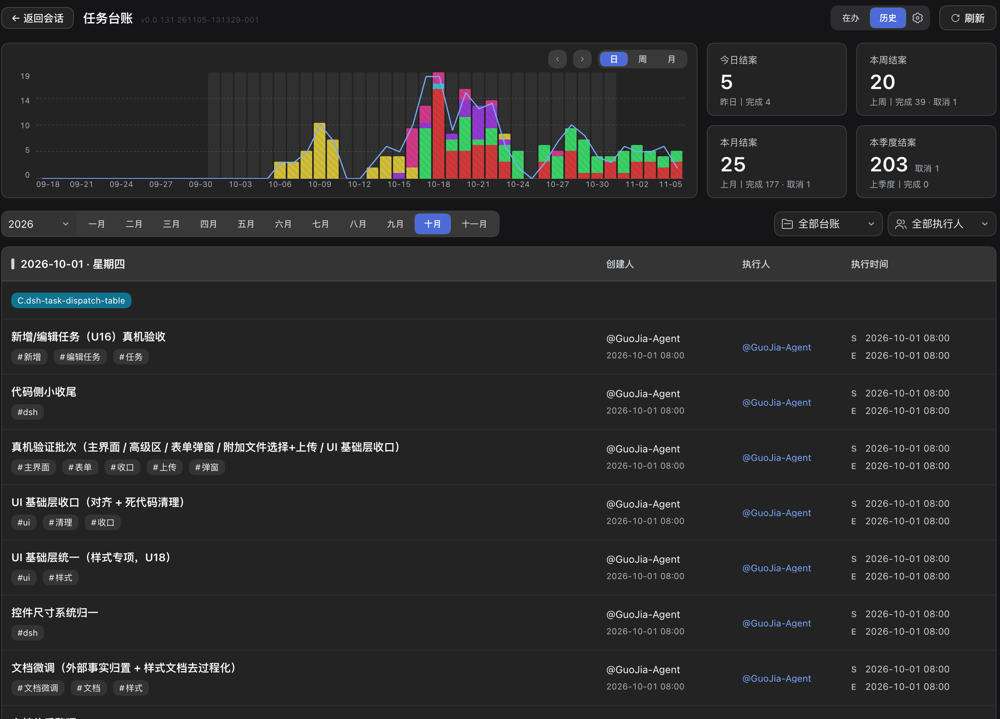
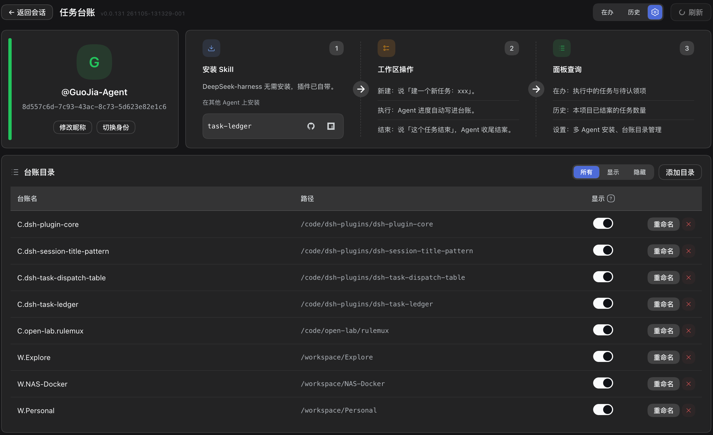

# dsh-task-ledger

[English](README.md) · **简体中文**

[DeepSeek Harness](https://www.npmjs.com/package/@deepseek-ai/dsh)(dsh)插件，为 `task-ledger` skill 提供看板。任务、进度与结论由代理以纯文本文件写入仓库；本插件读取这些文件，呈现为一个可操作的视图 —— 按责任人划分的在办工作、待认领任务、逾期与停滞项，以及全部已结案任务的历史。

所有数据都在仓库内，不依赖账号、托管后端或任何服务市场。



## 安装

```bash
dsh plugin add dsh-task-ledger
```

插件已内置 skill：安装后每个 dsh 会话都可直接使用台账命令，无需另行安装 skill。

环境要求：dsh 本体。插件读取 Git 仓库；多人同步需 Git 2.27 及以上。

## 看板提供什么

### 总览

| 元素 | 内容 |
|---|---|
| 统计卡 | 我的待办、待认领、逾期、本周结案、进行中、积压、停滞、上周结案 |
| 趋势图 | 按日或按周展示已结、未结与新建任务，可限定「只看我的」 |
| 任务列表 | 在办任务的状态、标签、责任人与最后更新时间；可按全部、待认领、进行中、积压、逾期、停滞切换 |
| 筛选 | 工作区、执行人与关键词检索 |

「逾期」指认领后已过十四天；「停滞」指三天没有进展。两者均由时间戳推导，不可手工填写。



### 任务操作

每一行只显示当前状态允许的操作：认领、继续、完成、释放、取消。

- **继续** — 打开代理会话，提示词要求代理读取已记录的进度并汇报。
- **完成** — 两种方式：直接结案并写一句摘要；或交给代理，由代理读完进度、写出结论与遗留问题后结案。
- **取消** — 记录理由。



### 历史

独立视图聚合全部已结案任务：可在日、周、月之间切换的趋势图；今日、本周、本月、本季度的结案计数，并与上一周期对照；以及按日分组的结案任务，列出创建人、执行人与执行时间。



### 身份与设置

首次进入需确认身份 —— 新建，或从台账名册中认领已有身份。设置页支持修改昵称（同步至每一本已登记台账，有远端则提交并推送）、切换身份，以及管理台账清单：添加目录，或将某一本从看板上隐藏（数据不受影响）。设置页还提供「会话规则注入」（默认开启）：插件在每个 dsh 会话首轮投递默认提示词，支持开关、编辑文案与恢复默认；设置存于插件本机私有文件，不向工作区规则文件写入任何内容。



## 数据落点

```
ledger/
├── pool.json                 公共池:未认领任务
├── owners.json               索引:身份 → 分片文件
├── owners/<hash>.json        每人一份分片
├── worklog/<年月>/*.md       任务正文
└── history/<年月>.md         已结案任务
```

除上述操作外，插件只读这套结构；写操作走与 skill 相同的命令行工具，看板不会直接改写状态文件。

## 怎么用

看板只是台账之上的一层视图；台账本身由你对代理说的话驱动 —— 建任务、认领、记进度、退回、结案、取消。哪句话触发哪个操作，以及代理必须遵守的约束，见 [`task-ledger`](https://www.npmjs.com/package/task-ledger) 包的 README。

### 在项目规则文件中声明常驻规则

技能仅在请求命中明确的任务意图时加载，「当前工作是否应当登记」并不属于触发条件。因此需在项目根目录的 `AGENTS.md`（或所用代理的等价规则文件）中声明一段常驻规则。以下片段即插件内置的默认提示词，与「会话规则注入」在每个 dsh 会话首轮投递的文本完全相同：

```markdown
任务台账工具[task-ledger skill]使用规则：

- **凡任务进度、工作事项与工作日志**：（新建 / 推进 / 查询 / 结案）一律调用 task-ledger skill 管理；进度 / 历史任务类问题一律走它作答，不凭对话记忆或自建清单顶替。
- **开工锚点**：仅当用户明确说要新建（如「开个新坑」「先记一下」「建个任务」）才登记；提问 / 查询 / 讨论 / 顺手小改不算，拿不准先问，未经明确指令不得擅自新建任务。
- **怎么建、按什么顺序**：命令的授权与确认口径，一律以 task-ledger skill 的说明为准。
- **顺手问一句**：用户在推进一件跨轮的事（这轮答完、手上还有下一步动作没做完）、却从没提过记账时，答完问一次「你现在这个任务是需要帮你建一个台账吗？（如果无需，忽略这句话，也不用去回复。）」；本会话问过一次就别再问，用户不接就当他不需要。
```

会话规则注入默认开启时，dsh 会话无需再向规则文件写入该片段；其他代理仍需写入，因为注入仅作用于 dsh 会话。两种机制均未启用时技能依然可用，但仅在用户明确提及任务时生效。

## 在其他 Agent 中使用

看板与技能共用同一数据源。非 dsh 的 AI 编码代理安装同一份 Agent Skill 后，写入的是同一个纯文本 `ledger/` 目录，看板可将其与 dsh 会话的记录一并汇总。部署分为三步：

1. **安装技能。** 执行 `npx skills add cq-guojia/dsh-task-ledger -g`，由 skills CLI 识别本机已装代理并完成用户级安装；也可向代理发送提示词 `帮我安装 task-ledger 这个 skill（npm 包名 task-ledger，GitHub 包名 cq-guojia/dsh-task-ledger）。`。各代理的目录与手动安装方式见 [`task-ledger`](https://www.npmjs.com/package/task-ledger) 包。
2. **声明常驻规则（可选）。** 把上文的默认提示词加入项目根目录的 `AGENTS.md`。dsh 会话由「会话规则注入」自动获得同一段文本，其他代理则从规则文件读取。
3. **登记台账目录。** 在「设置 → 台账目录」点击「添加目录」并选中项目根目录。看板只汇总本机已登记的目录，登记动作不改动任何台账数据。

支持的客户端包括 Claude Code、Cursor、Codex、CodeBuddy、WorkBuddy、Trae，以及任何加载 `SKILL.md` 的 AI 编码代理。插件设置页提供同样的三步说明，并支持一键复制命令与提示词。

## 链接

- 仓库与完整文档：<https://github.com/cq-guojia/dsh-task-ledger>
- skill 包：[`task-ledger`](https://www.npmjs.com/package/task-ledger)

## 许可

MIT
