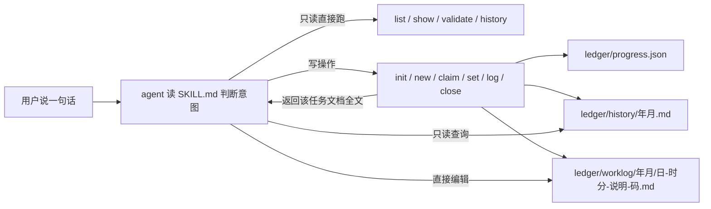
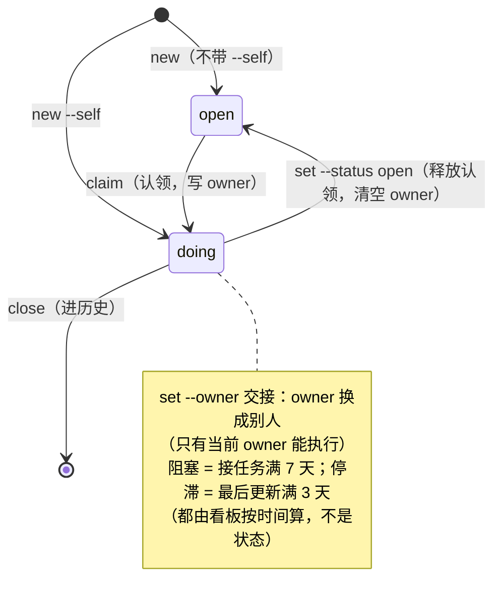

# task-ledger

> 这份文档**给人看**：它是什么、为什么这么设计、一次调用背后发生什么。
> 给 agent 的执行说明在 `SKILL.md`，两者不重复；`SKILL.md` 里**没有**引用本文件，所以它不会进 agent 上下文、不占 token。

## 一、它做什么

管一个项目 / 工作区的任务进度（开发活、琐事、调研、备忘都算），一共三件东西：

| 管什么 | 落在哪 | 谁写 |
|---|---|---|
| 在办任务的状态 | `ledger/progress.json` | **只由脚本写** |
| 每个任务的过程正文 | `ledger/worklog/<年月>/<日>-<时分>-<说明>-<随机码>.md` | **建档只由脚本按模板做**，之后正文 **agent 直接编辑** |
| 已结案任务，一行一条（8 列：结案时间 / 创建时间 / 工作包 / 分类 / 标签 / owner / 摘要 / 过程文档） | `ledger/history/<年月>.md`（按**结案时间**分月；存量 `ledger/PROGRESS-HISTORY.md` 只读兼容、永不重写） | **只由脚本写**；查询走 `history` 子命令 |

覆盖的动作：建任务、认领、交接、改状态、结案、查在办、查历史、体检。

典型场景：

- 问「现在该做什么 / 我还有什么没做完」→ 查在办
- 说「新建一个任务 / 这活我领了 / 卡住了 / 转给某人 / 这活做完了」→ 改状态或结案
- 问「某件老活是什么时候做的」「谁改过什么」「拉某人的工作日志」→ `history` 子命令（只读，可直接跑）

## 二、为什么这么设计

### 顶层目录为什么是 `ledger/`，不是 `docs/`

`docs/` 是**项目自己的地盘** —— 项目的文档规范、设计、样例都住在那里，各有各的规矩。
把进度三件套塞进 `docs/`，等于让「进度管理」去占用别人已经安排好的空间；
换一个没有 `docs/` 的项目、或项目把 `docs/` 用作别的用途，就又得重新商量放在哪。

所以本 skill 统一用**独立的 `ledger/` 目录**：任何项目、任何工作区都用同一个名字，
既不依赖项目原有的 `docs/`，也不与它发生关系（项目原有 `docs/` 原样不动、不进本体系）。
进度是「跨项目长一个样」的东西，就该有一个跨项目固定的家。

### 状态用 JSON，不用 Markdown

状态要频繁改（`open` → `doing` → 结案），Markdown 里改一个词很容易顺手改到别处。JSON 结构化、字段固定、一次只动一个值，改动面最小。

### 状态与过程正文分离

状态改动频繁、正文频繁重写，混在一个文件里必然互相踩。所以拆成两个文件：**JSON 只放数据，正文全在 `worklog/`**。JSON 里一个字的过程描述都不放 —— 一旦开始写段落，改动面就不可控了。

唯一进 JSON 的「文档类」信息是过程文档的**路径**（`worklog` 字段，如 `worklog/202610/06-0000-doc-arch-review-7a3c.md`）。它不是描述而是索引：按月分目录之后文件名不再等于任务号，靠推算容易找错，记一笔最省事。

### 历史层的 owner 是独立列

「谁改过什么」「拉某人的工作日志」靠 `history --owner` **精确匹配**。owner 必须独立成列，不能缝在工作包标题里：缝进去就只能文本搜索，`a` 会命中 `a-11`；切分也只能靠「最后一个 ` @`」这种启发式，标题里出现 `@`（如 `rulemux@0.1.0`）就切错。独立列让按人查退化成列比较，与 `list --owner` 查在办是同一套精确语义。

### 记录时间精确到秒，任务号 / 文件名只到分

两者用途不同，精度也不同：**任务号、worklog 目录与文件名**只到分（`年月日-时分` / `YYYYMM`）—— 够排序、够肉眼定位，且短；**所有记录时间**（`progress.json` 的 `created` / `started` / `finished`、历史表的时间列、worklog 头部的创建 / 封卷行）到**秒** —— 按时间段检索、比对都靠它，分不够。

写入前一律经 `normalize_time` 归一化：`2026-10-06`、`2026-10-06 14:30`、`2026-10-06 14:30:05` 都接受，缺的补 `00:00:00`。读旧数据时又**兼容只到分**的写法（老历史行照读不误），只有新写入的才带秒。

### 历史表为什么带创建时间

历史层的过滤口径是**创建时间**（`list` / `history` 的 `--since` / `--until` 都按它），因为「这活是什么时候建的」比「什么时候被结案」更常用、也更稳。所以历史行同时存**结案时间**（第一列）与**创建时间**（第二列）。升级旧行时创建时间先读它链接的 worklog 头部「创建」行，读不到用升级时刻 —— 不留空。

### 历史层为什么按月归档

`close` 每结案一行就往历史层追加，早期是单一文件 `ledger/PROGRESS-HISTORY.md`：项目一两年下来它无限增长，每次结案都要整文件读入、升级、重写 —— 结案成本随历史总量线性变差。

现在按**结案时间**分月落 `ledger/history/<年月>.md`，与 worklog 的 `ledger/worklog/<年月>/` 同构：

- **写入时分月，不做定时外挪** —— 外挪需要一个「谁定时触发」的角色，必然漂移；写入时分月零新增动作，且结案只碰当月小文件
- **存量文件原地只读** —— 改造前的 `ledger/PROGRESS-HISTORY.md` 永不重写、永不删除，读侧 glob 兼容；它里面的旧格式行也不会被自动升级（读侧三格式兼容 + `validate` 提示已覆盖）
- **文档链接跟着所在文件走** —— 行里的 worklog 链接相对该行所在的历史文件目录解析：存量文件里是 `worklog/…`，月文件里是 `../worklog/…`，两边都可点击、可定位
- **查询无感** —— `history` / `validate` 合并全部来源，过滤、排序、`--json` 行为不变；行尾附所在历史文件，`--json` 记录带 `src` 字段

### 状态文件只由脚本写

两个人（或两个 agent）同时编辑同一个文件会互相覆盖。脚本的写入靠两层保证：

1. **原子替换**：先写同目录的临时文件，再 `os.replace` —— 保证文件不会出现半截内容
2. **写前复查指纹**：读的时候记下文件的**内容哈希**（sha256），写之前再比一次；变了就报错中止、要求重跑。
   刻意不用 mtime+size —— 并发写入可能落在同一时间精度内、字节数又恰好相同，那样指纹不变，复查就形同虚设

第 2 条是**发现并中止**，不是自动合并 —— 它把「静默覆盖别人」变成「明确报错让你重来一次」。所以并发下偶尔会遇到「被改动过，重跑」，这是设计如此，不是 bug。

### worklog 头部只写不会变的东西

原设计里 worklog 头部带 `状态：open · owner：（待认领）`，实测发现：**`claim` 之后头部还写着 `open`，成了过期副本**。删掉 —— 状态真源只有 `progress.json` 一个。

现在头部只写两样**写入后就不再变**的：**创建时间 + 创建人**（`new` 建档时写）、**封卷时间 + 封卷人**（`close` 结案时追加）。会变的东西（状态、当前 owner）一律不写。

### 任务号 = 创建时间 + 语义名 + 4 位随机码

`登录接入 SSO`（2026-10-15 14:30 建的）→ `20261015-1430-登录接入-sso-1eed`。

- 前置 `年月日-时分`：一眼看出这个任务是什么时候建的，也天然按时间排序
- 中段语义名：一眼知道是什么任务（所以保留汉字，纯中文标题也能生成）
- 后缀 4 位随机码：**必须保留** —— 任务号只在在办任务里去重，而 worklog 结案后仍留在磁盘上，去掉随机码会让新任务与已结案的过程文档同名、覆盖历史
- 不用纯 UUID：文件名会变得完全不可读
- 想自己指定就传 `--id`

### owner 只认 git 身份，不做兜底

`owner` 一律取 `git config user.name`。取不到就**直接报错退出**（提示「需要用户名才能执行」），没有默认值、没有备选标识、没有降级路径。

理由：拿一个编造的身份去写"谁在做这个任务"，比写不进去危险得多。

### 只能改自己的任务

`set` 和 `close` 都先取身份，再校验「这个任务的 owner 是不是你」：**不是就拒绝**；任务还没人认领（`open`）也拒绝，提示先 `claim`。要接手就走 `set --owner` 交接 —— 一次显式动作。

理由有两层：一是别人替你结案，你会失去对进度的掌控；二是如果只取了身份却不校验归属，`owner` 这个字段就只是个装饰品。

### 不依赖任何框架注入的变量

早先写成 `{baseDir}/scripts/progress.py` —— 那是某一家的注入变量，换个 harness 就没有。现在写成「本 SKILL.md 所在目录」这种不依赖注入的表述。

同理，**项目位置必须由调用方用 `--repo` 传**：脚本只知道自己在哪，不可能知道你现在在哪个项目里干活。

### 并发策略

- 所有写命令（`init` / `new` / `claim` / `set` / `log` / `close`）走同一套：**读 → 改内存 → 复查指纹 → 原子写**
- 临时文件名唯一（`mkstemp`），写完 `fsync` 再 `os.replace`，无论成败都清理临时文件
- key 按字母序落盘，减少两人同时新增时的文本冲突
- 冲突时**报错要求重跑**，不静默覆盖
- 脚本里**没有任何** `git pull` / `rebase` / `commit` —— 冲突不要靠拉取去"解决"

### 结案是原子操作

`close` 一次完成三件事，**顺序是有意排的**：先写历史索引 → 再封卷过程文档 → **最后**才从状态表里移除。

为什么是这个顺序：万一中途崩溃，最坏结果是「历史多了一行、状态表里任务还在」，重跑一次就对上了；反过来先删状态、后写历史，崩溃会让任务**既不在状态表、也不在历史** —— 记录凭空消失。

落盘时任一步失败会**整体回滚**，并逐文件报告哪些恢复成功、哪些没成功（回滚本身失败时不会掩盖原始错误）。

### 分类与标签为什么不设枚举

本 skill 跨所有工作区使用（开发 / 运维 / 个人事务 / 调研备忘都算），任何固定枚举都覆盖不全、颗粒度难定；「让 Agent 判断会不准」也不能靠穷举分类消解。所以分两层、都自由：

- **`category` 单值**：答「这事是什么类型」。一条一值，`count by` 干净，是人眼扫视和看板统计的轴
- **`tags` 1~5 个**：答「这事涉及什么」（对象 / 领域 / 模块）。兜住长尾与新领域，写错了只影响一个切面

两层都只硬校验**形态**（≤4 字 / 纯英文 ≤3 词 / ≤5 个），不校验语义 —— 语义 correctness 交给口径（SKILL.md 的归一化规则 + 正反示例）和巡检归并机制，不交给枚举。

### category 精确匹配、tag 包含匹配

两种查询语义不同是有意的：category 是统计轴，同值才能比较，必须精确；tag 是容错下钻，「bug」命中「bug修复」正是包含匹配要的效果 —— 它天然吃掉一部分同义变体，剩下的漂移靠 `tags --all` 暴露、`tags --rename` 归并。

### 为什么只硬校验上限、不设标签数量下限

设下限（如必须 3 个标签）会逼 Agent 凑数 —— 凑出来的正是噪声，与「容忍错误」的初衷相反。上限（≤5）与字数（≤4 字 / 英文 ≤3 词）是形态红线，必须硬校验；数量只引导、不强制。

### 分类/标签进 history 列（2026-10-15 存量改造时加入）

初版设计是「不进列、回链读」：history 解析写死 6 列，加列要迁移存量。用户评审时要求反转——已结案记录也要能按分类/标签查，于是升为 **8 列**（结案时间 / 创建时间 / 工作包 / 分类 / 标签 / owner / 摘要 / 过程文档）：

- `close` 从 task 直写分类/标签终值（`--category`/`--tags` 覆盖过的用覆盖值）
- 存量 4/5/6 列由 `upgrade_history` 升级为 8 列：分类/标签**回链该行 worklog 头部**读（`labels_for_log`，与 created 回填同一模式），读不到留空、不编造
- 回链没有废弃：`history` 子命令对仍是 4/5/6 列的旧行（未升级文件）继续回链兜底，`cmd_history` 里「列空才回链」

代价说清：加列动了 parse/upgrade/close 全链路，靠「逐行按自己列数判别 + 不敢升级就按原列数追加」的老机制兜底；冒烟覆盖了 8 列写入、6 列升级（owner 剥 @ 防 `@@`）、4 列升级、坏行退回四条路径。

### rename 为什么不碰已封卷文档

与「封卷即不可变」同一哲学：rename 只改状态表与在办 worklog 头部；已结案记录的旧标签留在原文档里。这类残留在 `tags --all` 的频次表里可见，看板侧自行归并 —— 台账只做记录，不做历史改写。

### 「分类/标签」行为什么由 render 动态插入

不占模板占位符 ⇒ `assets/worklog.md` 与 `FALLBACK_TEMPLATE` 都不用改，两个模板永远一致；空值（存量任务、Agent 没总结）自动不写行，向后兼容零成本。生成、解析、覆盖三处共用 `label_line` 一个格式定义，防漂移。

## 三、运行逻辑

### 一次调用发生什么

### 状态机

- `done` **只能由 `close` 产生**；`set --status done` 会被拒绝
- **退回未认领**：owner 用 `set --status open` 把任务退回去，owner 清空、之后别人可以重新 `claim`；这条不能与 `--owner` 同时给
- `set --owner <某人>` 是**交接**，由当前 owner 执行，执行后 owner 换成那个人
- 状态表里不允许残留 `done`（`validate` 会报）

### 命令一览

| 子命令 | 作用 | 需要 git 身份 | 会返回任务文档全文 |
|---|---|---|---|
| `init` | 建状态表 | 否 | 否 |
| `new` | 建任务并建档 | **是**（记 creator） | 是 |
| `claim` | 认领待认领任务 | **是** | 是 |
| `set` | 改状态 / 交接 | **是**（且必须是该任务的 owner） | 是 |
| `close` | 结案归档 | **是**（且必须是该任务的 owner） | 否 |
| `list` | 查在办任务 | 仅 `--mine` | 否 |
| `history` | 查已结案任务（只读） | 仅 `--mine` | 否（只给过程文档链接） |
| `show` | 单任务详情 | 否 | 是 |
| `validate` | 校验一致性 | 否 | 否 |

参数细节看 `SKILL.md`，或直接跑 `<子命令> --help`。

### 返回什么

| 命令 | 返回 |
|---|---|
| `new` / `claim` / `set` / `show` | 状态行 + 该任务过程文档的**路径与全文** |
| `close` | 结案结果与摘要 |
| `list` | 在办任务列表（不含正文，避免撑爆上下文） |
| `history` | 已结案紧凑列表（默认不含摘要，避免撑爆上下文） |

返回文档全文是有意的：agent 拿到就能直接编辑，不用再去找文件、拼路径。
`history` 是唯一的例外：只回过程文档的**链接**，正文另读 —— 历史层摘要就是这套体系里唯一的「正文」，默认不吐。

### 失败约定

| 情况 | 行为 |
|---|---|
| 成功 | 退出码 0 |
| 业务错误（参数值 / 状态 / 权限不对） | 输出到 stderr，**退出码 1**，消息以「错误：」开头 |
| 命令行参数错误（argparse） | 退出码 2 |
| 未预期的内部失败 | 输出到 stderr，**退出码 3**（与可纠正的业务错误区分开） |
| 用户中断 | 退出码 130 |
| 输出被下游截断（如 `\| head`） | 静默退出，退出码 0，不打 traceback |

**报错就停下并原样报告，不要绕过脚本直接改 `ledger/progress.json` 或历史层（`ledger/history/<年月>.md`）。**

## 四、已知边界与待办

1. 本 skill 位于工作区 `_Skills/task-ledger/`；是否安装到全局 skill 目录由使用者决定 —— 未安装时其它项目不会自动触发。
2. `scripts/progress.py` 里的 `FALLBACK_TEMPLATE` 是**无注释的最小骨架**，只在 `assets/worklog.md` 读不到时启用 —— 两处注释多寡不同不是缺陷，**正例只放模板文件**。
