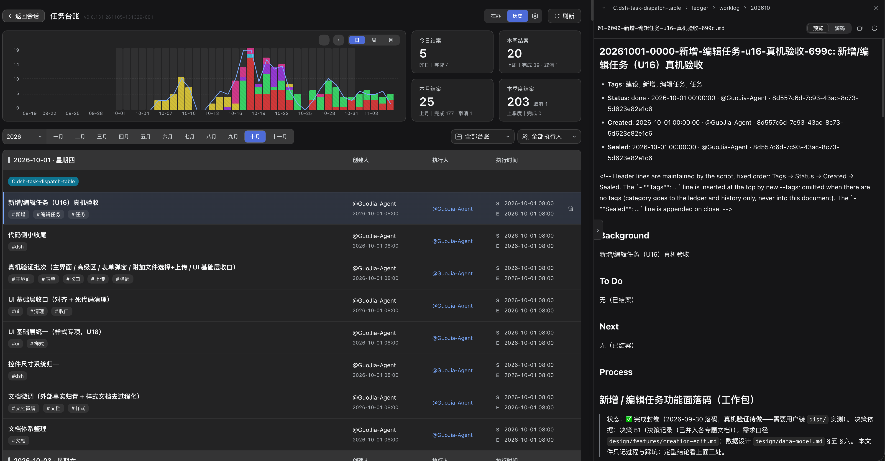

# task-ledger

[English](README.md) · **简体中文**

面向 AI 编码代理的任务台账。代理把正在做的事 —— 谁在做、做到哪一步、何时开始、何时结束 —— 以纯文本形式记录在仓库内，答案不会随对话结束而丢失。

本包是一个 skill：一份 `SKILL.md`、一个预编译命令行工具，以及若干参考资料。凡加载开放 `SKILL.md` 格式的代理均可使用：Claude Code、Cursor、Codex、CodeBuddy、WorkBuddy、Trae、豆包工作等。

它的定位由四点界定：

| 特性 | 具体含义 |
|---|---|
| **任务全生命周期跟踪** | 任务可创建、认领、续做、移交、结案。每次状态变更都带时间与责任人；过程、结论与遗留问题写入任务正文。 |
| **本地化工具** | 不需要账号、不需要托管后端、不依赖任何服务市场。台账是与仓库一同提交的 JSON 与 Markdown，离线可用，可在代码评审中审阅。 |
| **单人可用，多人亦可用** | 单机单人可直接使用；团队共用一个仓库同样成立。归属状态按人分片存储，并发推进时不会写同一份文件。 |
| **以 Git 承载版本同步** | Git 即传输通道。push、pull、merge 把台账带到其他机器与其他人。 |



## 安装

### 用技能管理器安装

[skills CLI](https://skills.sh)（Vercel）会识别本机已装的 agent，把 skill 写入各自目录，并支持后续更新：

```bash
npx skills add https://github.com/cq-guojia/dsh-task-ledger/tree/main/packages/skill
```

路径是命令的一部分：本仓库是 monorepo，内含两份同名副本，`packages/skill` 才是真源。加 `-g` 装到全局而非当前项目，加 `--agent` 限定目标 agent。

[SkillHub](https://skillhub.cn) 是 CodeBuddy 与 WorkBuddy 背后的技能市场，skill 上架后可直接安装。检索不到 `task-ledger` 时，改用客户端「导入本地技能」指向 `packages/skill`，或在 SkillHub 桌面版中把本仓库添加为 GitHub 来源。

### 手动安装

安装即：把 skill 目录复制到你所使用代理读取的技能目录。先取一份源码：

```bash
git clone --depth 1 https://github.com/cq-guojia/dsh-task-ledger.git /tmp/task-ledger-src
```

再按代理复制到对应位置。用户级目录对所有项目生效；项目级目录只对单个仓库生效，可随仓库提交，这是团队共用同一份 skill 的方式。

| 代理 | 用户级目录 | 命令 |
|---|---|---|
| **Claude Code** | `~/.claude/skills/` | `mkdir -p ~/.claude/skills && cp -R /tmp/task-ledger-src/packages/skill ~/.claude/skills/task-ledger` |
| **Cursor** | `~/.cursor/skills/` | `mkdir -p ~/.cursor/skills && cp -R /tmp/task-ledger-src/packages/skill ~/.cursor/skills/task-ledger` |
| **Codex CLI** | `~/.codex/skills/` | `mkdir -p ~/.codex/skills && cp -R /tmp/task-ledger-src/packages/skill ~/.codex/skills/task-ledger` |
| **CodeBuddy** | `~/.codebuddy/skills/` | `mkdir -p ~/.codebuddy/skills && cp -R /tmp/task-ledger-src/packages/skill ~/.codebuddy/skills/task-ledger` |
| **WorkBuddy** | `~/.workbuddy/skills/` | `mkdir -p ~/.workbuddy/skills && cp -R /tmp/task-ledger-src/packages/skill ~/.workbuddy/skills/task-ledger` |
| **Trae** | `~/.trae/skills/`（Trae 国内版：`~/.trae-cn/skills/`） | `mkdir -p ~/.trae/skills && cp -R /tmp/task-ledger-src/packages/skill ~/.trae/skills/task-ledger` |

**项目级安装。** 同样的复制方式也适用于仓库内：`.claude/skills/`、`.cursor/skills/`、`.codebuddy/skills/`、`.trae/skills/`，以及 Codex 与 Cursor 都能读取的跨代理约定目录 `.agents/skills/`。随代码一同提交，每位协作者便获得同一份执行说明。

**豆包工作。** 在应用内导入：打开侧栏，进入「技能」，将 `packages/skill` 作为本地技能导入。该应用未公开用户级技能目录，应用内导入是受支持的方式。

**其他代理。** 将目录放到 `.agents/skills/task-ledger/`，或该代理扫描 `SKILL.md` 的位置。本包不依赖任何宿主：命令行是静态二进制，内容均为 Markdown。

**Windows。** 将路径中的 `~` 替换为 `%USERPROFILE%\`；下面所有 `scripts/progress` 都要换成 `scripts\bin\ledger-windows-amd64.exe`（无扩展名的 sh 包装在 Windows 上不可执行：CreateProcessW 会按扩展名补 `.exe` 去找，然后报找不到）。在 Git Bash / WSL 里仍可用 `scripts/progress`。命令行提供 Linux（amd64）、macOS（arm64）与 Windows（amd64）三个平台的二进制。

## 首次使用

每台机器需执行一次身份初始化，此后所有台账记录均以该身份署名。该步骤为交互式，必须由你本人执行 —— 代理不得代为创建或改写身份：

```bash
~/.claude/skills/task-ledger/scripts/progress init
```

在第二台机器上，直接运行 `init` 并从台账名册中认领已有身份，两台机器便以同一账号写入。

此后无需任何运行时、包管理器或网络；多人同步需 Git 2.27 及以上。

## 怎么用

不需要你敲任何命令。台账由你对代理说的话驱动：请求命中下列意图时，代理执行对应操作并留痕。

| 你说 | 代理做什么 | 结果 |
|---|---|---|
| 「新建一个任务：把发布流程走通」 | 按你给的标签建任务 | 落公共池，状态「待认领」 |
| 「新建个任务并开始做」 | 建并认领 | 归你名下，状态「进行中」 |
| 「这活我领了」/「接着做 X」 | 认领该任务 | 转到你名下，状态「进行中」 |
| （干活过程中） | 写任务正文，再追加一条执行记录 | 进度、结论、卡点全程留痕 |
| 「卡住了」/「先放一放」 | 记下卡点，状态不动 | 仍是「进行中」—— 暂停既不是释放，也不是取消 |
| 「退回去」 | 释放任务 | 回公共池，任何人可认领 |
| 「这个任务结束掉」 | 带摘要结案 | 写入历史，此后只读 |
| 「取消 / 作废」 | 作废结案，记下原因 | 已关闭，但不算完成 |
| 「删除」 | 先请你确认，再删除 | 彻底删除，无撤销、无恢复 |
| 「现在该做什么」/「上周结了什么」 | 列在办、看单条、查历史 | 只读查询，不写任何东西 |

建任务需要两项输入：**做什么** —— 一句话，不加分类或项目名前缀；**涉及什么** —— 一到五个标签。分类可在建任务时给出，此后不可更改。

四条约束对代理生效：

- 建、认领、释放、结案、删除，没有一项由代理自行发起。每一项都需要你的明确指令；你只说了「做完了」这类含糊的话，它回问，而不是直接结案。
- 状态文件、历史文件、执行记录一律不由代理改动。它只能写任务正文的前五节。
- 结案前必须先把记录写完 —— 已结案的任务不能再写。
- 找不到对应任务时，它问你要不要新建，而不是替你登记你没要求登记的工作。

### 建议把它写进规则文件

skill 只在请求命中意图时才加载 —— 你手上这件活该不该记账，不在这几个触发词里。所以在项目的 `AGENTS.md`（或等价的代理规则文件）里放一段常驻规则，比只装 skill 稳得多。复制下面这块即可：

```markdown
- **凡任务进度、工作事项与工作日志（新建 / 推进 / 查询 / 结案）一律调用 `task-ledger` skill 管理**；进度 / 历史类问题一律走它作答，不凭对话记忆或自建清单顶替。
- **开工锚点**：仅当用户明确说要新建（如「开个新坑」「先记一下」「建个任务」）才交给 `task-ledger` 登记；提问 / 查询 / 讨论 / 顺手小改不算，拿不准先问，未经用户明确指令不得擅自新建任务。
- **顺手问一句**：用户在推进一件跨轮的事（这轮答完、手上还有下一步动作没做完）、却从没提过记账时，答完问一次「你现在这个任务是需要帮你建一个台账吗？（如果无需，忽略这句话，也不用去回复。）」；本会话问过一次就别再问，无回复就忽略。
```

不写这段也能用，只是它只在你明确提到任务时才会动。

## 落盘的数据

```
ledger/
├── pool.json                 公共池:未认领任务
├── owners.json               索引:身份 → 分片文件
├── owners/<hash>.json        每人一份分片:其名下任务
├── worklog/<年月>/*.md       任务正文,固定六节
└── history/<年月>.md         已结案任务,一行一条
```

状态与正文分离：JSON 记录归属与状态，Markdown 记录来龙去脉。只有命令行工具可写状态、历史与执行记录；代理只能写任务正文的前五节，其余一律不改。所有存盘时间一律为 UTC，输出时转换为本机时区。

## 命令

| 命令 | 用途 |
|---|---|
| `init` | 初始化或认领本机身份（一台机器一次） |
| `new` | 新建任务 |
| `claim` | 认领任务 |
| `set` | 释放任务、转交他人或整组替换标签 |
| `log` | 向任务正文追加一条执行记录 |
| `close` | 结案，并写入历史 |
| `delete` | 删除建错的任务 |
| `list` | 列出在办任务 |
| `show` | 查看单个任务 |
| `history` | 列出已结案任务 |
| `stats` | 汇总计数与趋势 |
| `owners` | 列出已知身份 |
| `root` | 判断某目录是否含台账 |
| `whoami` | 显示当前身份 |
| `validate` | 检查台账一致性 |

参数见 `scripts/progress <子命令> --help`；面向代理的工作流写在 `SKILL.md`。

## 多人协作

归属按人分片：每人名下的任务保存在各自的分片文件中，两人各自推进各自的任务时不会写同一份文件。Git 负责合并分片、任务正文与历史文件。若两人同时修改同一份任务正文，冲突范围仅限于该文件。

## 链接

- 仓库与完整文档：<https://github.com/cq-guojia/dsh-task-ledger>
- 内置本 skill 并提供看板界面的 dsh 插件：[`dsh-task-ledger`](https://www.npmjs.com/package/dsh-task-ledger)

## 许可

MIT
